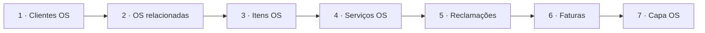
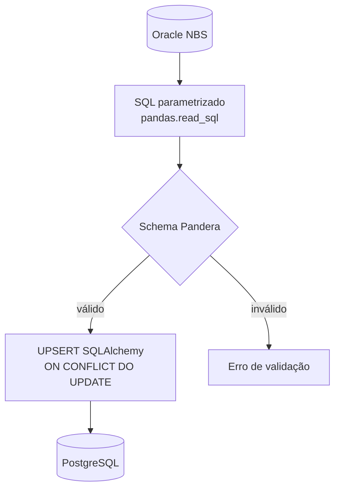

# Sync NBS Autodeal


Projeto de **integração de dados** entre o **Dealer Management System** (DMS - Sistema de Gestão de Concessionárias) da **NBS** (Oracle) e a **API de ingestão do Autonox**. O PostgreSQL é usado como staging e como controle persistente da fila de sincronização.

As ordens de serviço e seus dados relacionados são extraídos para o PostgreSQL, consolidados em payloads por OS e enviados ao Autonox. Os componentes e regras do fluxo estão detalhados no [blueprint da integração](./docs/spdd/spdd_autonox_blueprint.md).


## Finalidade

- Extrair dados operacionais do NBS (ordens de serviço e entidades relacionadas).
- **Validar** os resultados com **Pandera** antes do carregamento.
- Persistir no Postgres com **UPSERT** (insert ou atualização em conflito de chave), via **SQLAlchemy**.
- Consolidar os dados de cada OS em um payload validado e enviá-lo à API do Autonox usando uma fila *outbox* persistida no PostgreSQL.
- Permitir execução **manual** (script Python) ou **agendada** com **Apache Airflow** (projeto no padrão **Astronomer Astro**).

## O que o pipeline faz

O fluxo segue uma ordem fixa: primeiro as tabelas “satélites” (detalhes em torno da OS) e por último a **capa da ordem de serviço**. Isso evita inconsistências quando se usa datas máximas no destino para cargas incrementais — a capa não deve ser a única entidade carregada antes dos detalhes.

| Etapa | Conteúdo |
|--------|-----------|
| 1 | Clientes vinculados às ordens de serviço (abertas e encerradas) |
| 2 | Ordens de serviço relacionadas |
| 3 | Itens das ordens de serviço |
| 4 | Serviços das ordens de serviço |
| 5 | Reclamações das ordens de serviço |
| 6 | Faturas das ordens de serviço |
| 7 | **Capa** das ordens de serviço (incluindo canceladas, conforme SQL da etapa) |

Após a extração, o serviço de sincronização identifica OS novas ou atualizadas, registra-as em `autonox_outbox` e processa a fila em lotes. Cada payload combina a capa da OS com cliente, OS relacionadas, reclamações, serviços, peças e notas fiscais. O identificador da empresa e o número da OS são únicos na outbox; falhas de envio são registradas para nova tentativa sem repetir a extração do Oracle.

### Diagramas (Mermaid)

**Sequência das etapas** — mesma ordem em `include.extract_stages.run` e no DAG `pipeline_01_nbs_to_postgres`, definido em `dags/nbs_to_postgres.py` (tasks encadeadas):




**Padrão técnico de cada etapa** — consulta ao NBS, validação e gravação incremental no destino:



Cada etapa consulta o **Oracle** (SQL parametrizado), valida o **DataFrame** com o schema Pandera correspondente e grava no **Postgres** com `ON CONFLICT DO UPDATE`.

Para cargas incrementais, a extração usa a maior data já presente nas colunas de controle. Se ainda não houver data no destino, usa `autonox_sync_config.data_inicial_integracao`. A configuração global inclui `enqueue_limit` (500), `batch_size` (50) e `max_attempts` (5); os valores existentes são preservados nas execuções seguintes. A DAG `pipeline_00_seed_config` permite inicializar a configuração manualmente. A execução direta do pipeline também chama a seed antes da extração, e o serviço de sincronização garante a configuração ao iniciar. Em bancos existentes, a seed migra a menor data inicial das empresas ativas para a configuração global.

## Requisitos

- **Python** `>= 3.12, < 3.15` (definido no `pyproject.toml`).
- **uv** para gerenciamento de dependências e execução local ([instalação](https://docs.astral.sh/uv/getting-started/installation/)).
- **Oracle Instant Client** (modo *thick* do `oracledb`): o caminho da pasta do client deve estar em `ORACLE_DRIVER` no `.env` (instruções na secção seguinte, *Oracle Instant Client (execução local)*).
- **PostgreSQL** acessível com usuário, senha, host, porta e nome do banco.
- Para o **Airflow local** no modelo Astro: **Docker** e [**Astro CLI**](https://www.astronomer.io/docs/astro/cli/overview) (`astro dev`).

## Configuração

1. Copie o modelo de variáveis:

   ```bash
   cp .env_sample .env
   ```

2. Edite o `.env` na raiz do repositório (o carregamento usa `Path.cwd() / '.env'`).

### Oracle Instant Client (execução local)

O código chama `oracledb.init_oracle_client(lib_dir=...)` com o valor de `ORACLE_DRIVER`. Os binários do **Instant Client** são grandes e **não devem ser commitados** — por isso a pasta `include/infra/oracle/instantclient_23_8/` está no `.gitignore`.

**Download e instalação (Windows, exemplo 23.x):**

1. Baixe o pacote **Instant Client Basic** (ou **Basic Light**) para **Windows x64** na página oficial da Oracle: [Oracle Instant Client para Microsoft Windows (x64)](https://www.oracle.com/database/technologies/instant-client/winx64-64-downloads.html). É necessário aceitar a licença e, se pedido, criar/login em conta Oracle.
2. Crie a pasta do projeto (vazia no Git): `include/infra/oracle/instantclient_23_8/`.
3. Extraia o **conteúdo** do ZIP para dentro dessa pasta. Deve haver bibliotecas como `oci.dll` nesse diretório (layout padrão do ZIP da Oracle).
4. No `.env`, defina por exemplo:
   - `ORACLE_DRIVER=include\infra\oracle\instantclient_23_8`, ou
   - caminho **absoluto** para a mesma pasta, se preferir (útil se executar de outro diretório de trabalho).
5. Se ocorrer erro de DLL ao conectar, instale o [**Microsoft Visual C++ Redistributable**](https://learn.microsoft.com/pt-br/cpp/windows/latest-supported-vc-redist) na arquitetura x64, conforme a [documentação do Instant Client](https://www.oracle.com/database/technologies/instant-client.html).

No **Linux** (incluindo a imagem Docker deste repositório), o `Dockerfile` instala o client em `/opt/oracle/instantclient_23_9`; use `ORACLE_DRIVER` coerente com o ambiente.

### Variáveis principais

| Variável | Uso |
|----------|-----|
| `INTEGRATION_START_DATE` | Data inicial padrão (`YYYY-MM-DD`) gravada em `autonox_sync_config.data_inicial_integracao` quando a seed cria a configuração global pela primeira vez e não há data antiga para migrar. |
| `AUTONOX_API_URL` | URL da API Autonox gravada em `autonox_sync_config.api_url` quando a seed cria a configuração global pela primeira vez ou migra uma configuração existente sem URL. |
| `ORACLE_*` | `USERNAME`, `PASSWORD`, `HOST`, `PORT`, `SERVICE`, e `DRIVER` (pasta do Instant Client). |
| `POSTGRES_*` | `USERNAME`, `PASSWORD`, `HOST`, `PORT`, `SERVICE` (nome do banco). |
| `AIRFLOW__CORE__ALLOWED_DESERIALIZATION_CLASSES` | Necessário no ambiente Airflow se tasks retornam/serializam tipos dos pacotes de schema (valor de exemplo no `.env_sample`). |

No **Windows**, use `ORACLE_DRIVER` apontando para a pasta local ignorada pelo Git (ex.: `include\infra\oracle\instantclient_23_8`). No **Linux** / imagem Docker, o Dockerfile usa `/opt/oracle/instantclient_23_9`.

Conexões locais do Airflow (somente desenvolvimento) podem ser declaradas em `airflow_settings.yaml`, conforme a [documentação Astro](https://www.astronomer.io/docs/astro/cli/develop-project).

## Como executar

### Pipeline só com Python (sem Airflow)

Na raiz do projeto, com o `.env` configurado e o Instant Client disponível:

```bash
uv sync
uv run python -m include.pipeline
# equivalente: uv run task run
```

Isso executa a seed de configuração, as sete etapas de extração e, em seguida, a inclusão e o processamento de OS na outbox para envio à API Autonox.

### Com Airflow (Astro)

O projeto disponibiliza três DAGs:

- **`pipeline_00_seed_config`** ([`dags/seed_config.py`](./dags/seed_config.py)): execução manual (`schedule=None`) para inicializar as configurações.
- **`pipeline_01_nbs_to_postgres`** ([`dags/nbs_to_postgres.py`](./dags/nbs_to_postgres.py)): extrai as sete etapas do Oracle para o PostgreSQL, em sequência. Executa a cada hora, no minuto 0, de segunda a sábado (`0 * * * 1-6`), sem *catchup*.
- **`pipeline_02_autonox_outbox_sync`** ([`dags/autonox_outbox_sync.py`](./dags/autonox_outbox_sync.py)): identifica OS novas ou alteradas, enfileira-as e processa a outbox em sequência. Executa a cada 15 minutos (`*/15 * * * *`), sem *catchup*. As tasks têm uma tentativa de retry após dois minutos.

Com Astro CLI instalado:

```bash
astro dev start
```

Na primeira configuração, execute manualmente `pipeline_00_seed_config` pela UI do Airflow antes da DAG de extração. Em seguida, habilite as DAGs de extração e sincronização. A DAG de sincronização faz a seed ao iniciar o serviço, e pode processar OS já disponíveis no staging mesmo se a extração não tiver acabado de rodar. Acompanhe as execuções e eventuais falhas pela UI do Airflow. A imagem customizada está no `Dockerfile` (runtime Astro + Instant Client Oracle).

### Deploy em servidor com Astro e Docker Compose

O Airflow continua sendo iniciado e gerenciado pelo Astro CLI com `astro dev start`. O `docker-compose.yml` deste repositório sobe **somente** o PostgreSQL da aplicação (`postgres-stage`); ele não inicia outro Airflow nem outro banco de metadados do Airflow. O Postgres de metadados usado pelo ambiente Astro permanece separado.

Na raiz do projeto no servidor, copie `.env_sample` para `.env` e configure as credenciais Oracle e PostgreSQL. Ajuste `POSTGRES_BIND_ADDRESS` para o IP privado do servidor acessível pelos containers do Astro e `POSTGRES_HOST` para o mesmo endereço. Por exemplo, se o IP privado do servidor for `192.168.1.10`, use esse endereço nos dois campos. O container do banco escuta internamente na porta `5432`; `POSTGRES_PUBLISHED_PORT`/`POSTGRES_PORT` definem a porta do host, por padrão `5433`, evitando conflito com o PostgreSQL de metadados do Astro. Restrinja a porta publicada no firewall para que apenas o servidor/Airflow possa acessá-la; não exponha o banco à internet.

Suba o banco stage e, em seguida, o Airflow pelo Astro:

```bash
docker compose up -d
docker compose ps
astro dev start
```

O PostgreSQL é criado vazio na primeira inicialização. Os dados do stage são mantidos no volume Docker `stage_postgres_data`; `docker compose down` preserva esse volume, enquanto `docker compose down -v` o apaga.


## Estrutura útil do repositório

- `include/` — Lógica da pipeline: `extract_stages`, controllers, SQL, modelos SQLAlchemy, schemas Pandera, infra Oracle/Postgres.
- `dags/` — DAGs Airflow para inicialização da configuração, extração NBS e sincronização da outbox com a API Autonox.
- `.astro/` — Metadados do projeto Astro CLI (ex.: `config.yaml`) e utilitários de teste/integridade opcionais.
- `Dockerfile` — Imagem de execução com Oracle client para deploy/desenvolvimento Astro.
- `requirements.txt` — Dependências pip usadas na imagem Docker (alinhadas ao projeto).
