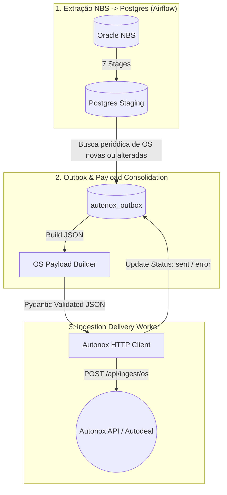

# Blueprint da Integração NBS -> Autonox (Autodeal / BMW)

> **Objetivo**: Registrar a arquitetura e o fluxo de sincronização implementados no projeto `nbs_extract_autodeal`.

---

## 1. Arquitetura da integração

O sistema extrai dados operacionais do Oracle NBS para tabelas de staging no PostgreSQL. Em seguida, consolida os dados de cada Ordem de Serviço (OS) em um payload JSON e envia o documento para a API de ingestão do Autonox (`/api/ingest/os`).

O PostgreSQL mantém tanto os dados de staging quanto o estado da entrega na tabela `autonox_outbox`. A extração do Oracle e o envio para a API são executados por DAGs independentes, de modo que a fila possa ser processada sem repetir a extração.

O fluxo é composto por três DAGs: inicialização manual da configuração, extração agendada e sincronização agendada da outbox.



## 2. Componentes

### Extração NBS para PostgreSQL

- O DAG `pipeline_01_nbs_to_postgres`, em `dags/nbs_to_postgres.py`, executa sete etapas em sequência: clientes, OS relacionadas, itens, serviços, reclamações, faturas e capa da OS.
- Cada etapa consulta o Oracle, valida os dados com Pandera e grava no PostgreSQL por *upsert*.
- A carga incremental usa a maior data existente nas colunas de controle ou, quando ainda não há dados, `autonox_sync_config.data_inicial_integracao`.

### Outbox e envio ao Autonox

- `SyncService.enqueue_updated_orders()` identifica OS sem registro na outbox ou com atualização posterior ao último processamento, usando a chave composta (`cod_empresa`, `numero_os`).
- `OSPayloadBuilder` consulta as tabelas de staging e monta o payload consolidado, validado pelo schema Pydantic.
- `AutonoxHttpClient` envia o payload à API usando a chave da empresa ativa configurada em `autonox_empresa_config`.
- `SyncService.process_outbox()` processa registros `pending` e `error` em lotes e atualiza estado, tentativas e informações de resposta. Após atingir `max_attempts`, o registro recebe o estado `failed_dead_letter`.
- A falha de uma OS é registrada individualmente; o processamento continua para os demais registros do lote.

### Estrutura do projeto

```text
dags/
├── seed_config.py             # Inicialização manual das configurações
├── nbs_to_postgres.py         # Extração Oracle NBS -> PostgreSQL Staging
└── autonox_outbox_sync.py     # Outbox -> API Autonox
include/
├── extract_stages/            # 7 etapas de extração Oracle -> Postgres
├── infra/                     # Conexões e engines (Oracle, Postgres)
├── data/
│   ├── models/                 # Configurações e estado da outbox
│   ├── schemas/                # Schema Pydantic do payload Autonox
│   └── seeds/                  # Configuração inicial global e por empresa
├── builders/
│   └── os_payload_builder.py  # Consolidação dos dados da OS
├── clients/
│   └── autonox_client.py      # Cliente HTTP da API Autonox
└── services/
    └── sync_service.py        # Enfileiramento e processamento da outbox
```

## 3. Execução e configuração

- `pipeline_00_seed_config` (`dags/seed_config.py`) é manual (`schedule=None`) e inicializa configurações globais e de empresas.
- Na primeira configuração do ambiente, execute essa DAG antes da DAG de extração.
- `pipeline_01_nbs_to_postgres` executa `0 * * * 1-6`: a cada hora, de segunda a sábado, sem *catchup*.
- `pipeline_02_autonox_outbox_sync` executa `*/15 * * * *`: a cada 15 minutos, sem *catchup*. As tasks de sincronização têm um retry após dois minutos.
- A seed define `enqueue_limit`, `batch_size`, `max_attempts` e `data_inicial_integracao`; valores já configurados são preservados. Em configurações antigas, a data inicial global é migrada da menor data das empresas ativas.
- A execução direta pelo módulo `include.pipeline` realiza a seed, a extração e a sincronização em sequência. O serviço de sincronização também garante a inicialização das tabelas e configurações ao ser criado.

`INTEGRATION_START_DATE` fornece a data inicial quando a configuração global ainda não existe e não há uma data antiga para migrar. `AUTONOX_API_URL` fornece a URL inicial da API Autonox; ambos os valores configurados são preservados nas execuções seguintes. `autonox_sync_config` também mantém `enqueue_limit` (500), `batch_size` (50) e `max_attempts` (5) como valores padrão.
